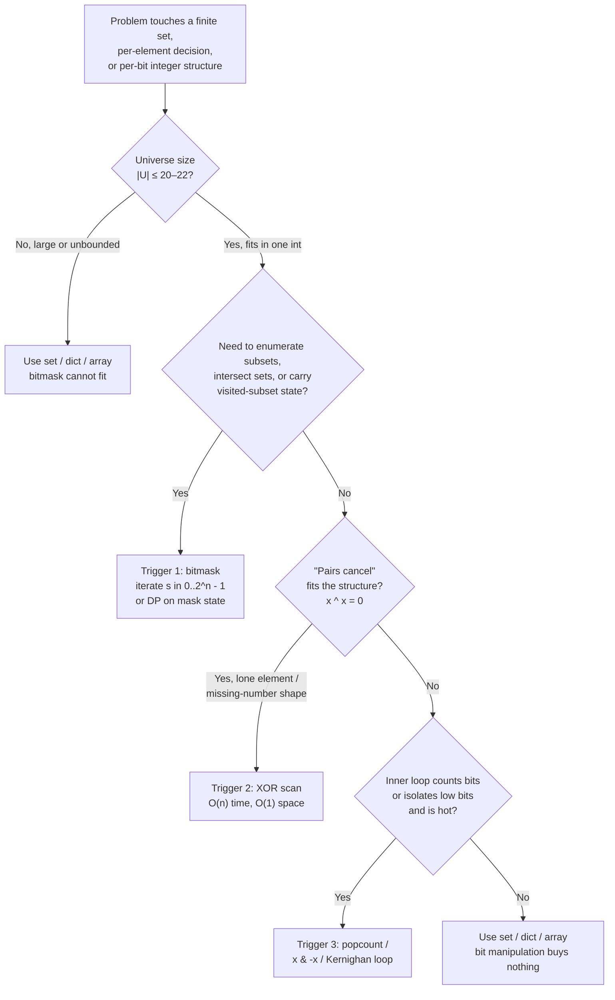

# When to reach for bit manipulation

Most code that reaches for bit manipulation does not need it. The `x << 1` that the author wrote because it "is faster than `x * 2`" compiles to the same instruction the multiplication would have. The XOR-swap idiom is slower than a temp variable on every CPU shipped after 1995. The clever `mask & (mask - 1)` loop the senior reviewer cannot decode is a code-review tax with no measurable wallclock dividend. Ninety percent of the time, the right tool is a `set`, a `dict`, an `int`, or a list of booleans, and the bit-twiddle is a flex.

The remaining ten percent is what this page is about. There are three problem shapes where the conventional encoding loses to a bitmask not by a constant factor but by the fact that nothing else fits. They are: state encoded as a bitmask when the universe is small, XOR exploited as the group operation when pairs need to cancel, and bit-counting tricks when the inner loop is genuinely hot. Pick one of those three triggers or default to a regular data structure; do not pick "bit manipulation feels clever."

## The decision

**The question:** does the problem require a bitmask, an XOR cancellation, or a popcount-style trick, or does a `set`/`dict`/`int` solve it just as well?

**The answer:** reach for bits when, and only when, exactly one of three triggers fires:

1. **State-as-bitmask.** The universe of possible elements has size `|U| ≤ 20–22`, and the algorithm needs to enumerate subsets, intersect sets, or carry "which subset has been visited so far" as state. Below `|U| = 22` a 32-bit integer encodes any subset; above it, `2^|U|` exceeds memory budgets and the trick stops working anyway.
2. **XOR for self-cancellation.** Every element pairs off except one, or the answer is structured around symmetric difference. XOR's self-inverse property (`x ^ x = 0`) is the unique tool that achieves O(1) extra space on this family.
3. **Bit-counting / popcount / Brian Kernighan.** The inner loop counts bits, isolates the lowest set bit, or walks set bits in a sparse integer. Hardware POPCNT runs in three cycles; the algorithmic version (`n &= n - 1`) runs `popcount(n)` iterations rather than 32.

If none fires, write the `set` version. The conventional form is shorter, debuggable on the second read, and indistinguishable in asymptotic complexity once the universe grows beyond 64.

## The flowchart

*Three triggers, one default. If none of the three branches fires, the conventional encoding wins. Bit manipulation is not a tiebreaker; it is a tool for the cases where nothing else fits.*

## Algorithms compared

The triggers are independent. A problem that fires trigger 2 (XOR) usually does not fire trigger 1 (bitmask state); a problem that fires trigger 3 (popcount) is usually a sub-step inside a larger algorithm. Each subsection below tells you what the trigger looks like at the whiteboard, what the algorithm costs, and which chapter goes deeper.

### Trigger 1 — State as a bitmask, when `|U| ≤ 20–22`

**The signal.** The problem has a fixed small universe (the 26 lowercase letters, the 5 vowels, an `n`-element ground set with `n ≤ 20`), and the algorithm needs to track *which subset is currently in play*. The natural state is a `set`; the bit-encoded state is a single integer where bit `i` indicates whether element `i` is in the subset. Set union becomes `m1 | m2`. Set intersection becomes `m1 & m2`. Subset enumeration becomes `for s in range(1 << n)`. Subset-of-subset enumeration becomes Knuth's `s = (s - 1) & m`.[^1][^2]

**The hard cap.** At `n = 20`, `2^n` is about a million; a million-element memo table fits in roughly four megabytes and runs in under a second. At `n = 22`, the table holds four million entries, still tractable. By `n = 24` the cache misses double the wallclock; by `n = 30` the algorithm does not run at all. The 20–22 ceiling is not arbitrary; it is the largest `n` at which `2^n` operations fit a contest budget.[^2]

**When to pick.** When the input has a small fixed alphabet AND the inner loop is shaped like "what is the union/intersection/subset relationship" or "iterate over every subset of a small ground set." Subset enumeration in LC 78 *Subsets* and bitmask DP in LC 847 *Shortest Path Visiting All Nodes* are the signature applications; both fit `n ≤ 20`. The cross-pattern decision page [Bitmask DP archetypes](./P-33-bitmask-dp-archetypes.md) routes the four DP shapes that depend on this encoding.

**Time and space.** Subset enumeration is `O(n · 2^n)` work, `O(2^n)` state. Bitmask DP variants run from `O(n · 2^n)` (assignment-style, where position is implicit in `popcount(mask)`) to `O(n^2 · 2^n)` (TSP-style, where the state grows a `last` dimension).

**Chapter cite.** [Bitmask techniques](../part-11-bit-manipulation/02-bitmask-techniques.md) carries the full enumeration mechanics and the `s = (s - 1) & m` derivation.

### Trigger 2 — XOR for self-cancellation (the LC 136 family)

**The signal.** The problem says "every element appears twice except one," "find the missing number in `[0, n]`," "two elements appear once and the rest pair up," or "the answer is the symmetric difference of two sets." The combinatorial structure is that pairs annihilate. XOR is the unique constant-space algorithm because XOR over `{0,1}^n` is an abelian group: `0` is the identity, every element is its own inverse, and the operation is commutative and associative.[^3] Reduce the array under XOR and the pairs cancel to zero; the lone element survives because `0 ^ x = x`.

**Why XOR specifically.** No other arithmetic operator has this combination of properties on bit vectors. Addition is commutative and associative but not self-inverse: `x + x` is `2x`, not `0`. Subtraction is self-inverse but not commutative. Modular arithmetic gets close but introduces overflow handling. XOR is the group operation on `({0, 1}^n, ⊕)`, full stop, and that is why the LC 136 family has a one-line solution and no other family does.

**When to pick.** When the prompt's invariants involve pairing AND the constraint says O(1) extra space. LC 136 *Single Number* is the canonical instance. LC 268 *Missing Number* is the same algebra applied to the consecutive integers `0..n`: XOR all of `0..n` and all of the array; everything cancels except the missing element. LC 260 *Single Number III* extends the family with a partition trick: XOR all elements to get `a ^ b`, then split the array by any bit set in `a ^ b` and run two LC-136 sub-problems.

**Time and space.** O(n) time, O(1) extra space, four lines of code. The conventional alternative, `Counter(arr)` or a `set`, also runs in O(n) time but uses O(n) extra space. When the prompt says "constant extra space" or asks "can you do this in O(1) space?", XOR is the unique answer.

**Chapter cite.** [XOR patterns](../part-11-bit-manipulation/01-xor-patterns.md) walks the family in full, including LC 136, LC 137, LC 260, LC 268, and the prefix-XOR variant of range queries.

### Trigger 3 — Bit-counting, popcount, and the Brian Kernighan trick

**The signal.** The inner loop needs to count set bits, isolate the lowest set bit, or walk only the set bits of a sparse integer. The naive scan iterates 32 (or 64) times regardless of input. The bit-twiddle alternative iterates `popcount(n)` times, once per set bit. On dense inputs the two are tied; on sparse ones the bit-twiddle wins by a factor of up to 32.

**The two load-bearing identities.** `n &= n - 1` clears the lowest set bit, which is Brian Kernighan's published trick from K&R exercise 2-9.[^4] `x & -x` isolates the lowest set bit as a power-of-two value, which is the workhorse for Fenwick-tree index walks. Both identities derive from two's-complement arithmetic: `-x` is `~x + 1`, the carry from the `+1` propagates through trailing zeros and stops at the lowest set bit, and the AND with the original keeps only that bit.[^4]

**When to pick.** When the inner loop is genuinely hot AND the integers are sparse enough that `popcount(n) << 32`. Production code does not write Kernighan's loop directly; it calls `Integer.bitCount` (Java), `__builtin_popcount` (GCC C/C++), `std::popcount` (C++20), `bits.OnesCount32` (Go), or `int.bit_count()` (Python 3.10+). All of these compile to one CPU instruction (`POPCNT` on x86-64 since 2008, `CNT` on ARMv8) on hardware that supports it.[^5] The hand-written loop is the teaching version and the portable fallback for compilers without an intrinsic.

**Time and space.** O(popcount(n)) per call for the Kernighan loop, O(1) per call for the hardware intrinsic, O(1) auxiliary space either way.

**Chapter cite.** [Bit operations cookbook](../part-11-bit-manipulation/00-bit-operations-cookbook.md) carries the seven primitive operations; [Bit tricks for performance](../part-11-bit-manipulation/03-bit-tricks-performance.md) covers SWAR popcount, de Bruijn sequences, and when stdlib intrinsics are the actual call site.

## Side-by-side

| Trigger | Signal at the whiteboard | Time | Space | Common pitfall | When to pick |
|---|---|---|---|---|---|
| **Bitmask state** | Universe `\|U\| ≤ 20–22`; need to enumerate subsets or track visited-subset state | `O(n · 2^n)` to `O(n^2 · 2^n)` | `O(2^n)` | Encoding the wrong dimension; masking 60 candidates instead of 16 requirements blows up state from 65K to 10^18 | LC 78, LC 847, LC 1125, bitmask DP from [P-33](./P-33-bitmask-dp-archetypes.md) |
| **XOR self-cancellation** | "Every element pairs except one" or "find the symmetric difference"; constraint demands O(1) extra space | `O(n)` | `O(1)` | Forgetting `0 ^ x = x` and writing a special case for the single-element array | LC 136, LC 137, LC 260, LC 268 |
| **Popcount / low-bit** | Inner loop counts bits, isolates `x & -x`, or walks set bits in a sparse integer | `O(popcount(n))` per call (Kernighan); `O(1)` per call (intrinsic) | `O(1)` | Writing Kernighan when the stdlib intrinsic compiles to one POPCNT instruction | LC 191, LC 461, LC 338, Fenwick-tree index walks |
| **(no trigger fires)** | None of the three signals match | matches conventional algorithm | matches conventional algorithm | Reaching for bits "for performance" with no measurement | `set`, `dict`, `Counter`, `bool[]`, etc. |

The pattern across the row is that bit manipulation buys you something specific: a small-universe encoding, a constant-space cancellation, or a sparse-iteration speedup. When the row's "common pitfall" applies to your draft solution, that is the signal to back out and rewrite in the conventional form.

## Three signature problems

One per trigger. Each is the cleanest example of its category, and the trigger is visible from the constraint section in under a minute.

**Bitmask state: [LC 78 — Subsets](https://leetcode.com/problems/subsets/)** (Medium). Given an array of `n` distinct integers with `1 ≤ n ≤ 10`, return all `2^n` subsets. The constraint `n ≤ 10` is the giveaway: that is small-universe territory, and `2^n` enumeration is the canonical encoding. The loop is `for s in range(1 << n)`; for each `s`, bit `i` indicates whether `nums[i]` is included. Same asymptotic cost as recursive backtracking, no stack, trivially parallelizable.

**XOR self-cancellation: [LC 136 — Single Number](https://leetcode.com/problems/single-number/)** (Easy). An array where every element appears twice except one, return the lone element, in O(n) time and O(1) extra space. The accepted solution is `reduce(arr, ^)`, four lines including the function header. Pairs cancel because XOR is self-inverse; the lone element XORed with `0` (the accumulator's initial value) is itself.

**Popcount: [LC 191 — Number of 1 Bits](https://leetcode.com/problems/number-of-1-bits/)** (Easy). Count the set bits of a 32-bit unsigned integer. The Brian Kernighan loop `while n: n &= n - 1; count += 1` runs `popcount(n)` iterations rather than 32, beating the naive scan on every sparse input. In production, call the stdlib intrinsic; in the interview, write Kernighan and mention the intrinsic out loud.

## Common misconceptions

Five mistakes recur in interview retrospectives and code reviews. Each one reduces to misreading the trigger.

**"Bit manipulation is faster than arithmetic."** Mostly false, and the conviction is harmful. Modern compilers strength-reduce `x * 2` to `x << 1` automatically; they strength-reduce `x % 2` to `x & 1` automatically; they strength-reduce `x / 8` to `x >> 3` for unsigned types automatically. The compiled output is identical. The author who writes `x << 3` instead of `x * 8` for "performance" buys zero microseconds and pays a real readability cost; every reviewer has to reconstruct the intent. The narrow exception is when the operation genuinely cannot be expressed as standard arithmetic (`x & -x`, `x & (x - 1)`, the masked-popcount idiom), at which point the bit-twiddle is the actual algorithm, not a microoptimization. Reach for `<<` and `>>` when the *meaning* is "shift bits"; reach for `*` and `/` when the meaning is "multiply" or "divide." The compiler does not care; the next reader does.

**"XOR is just clever."** No: XOR is algebraic. The reason `reduce(arr, ^)` solves LC 136 is not that XOR happens to cancel pairs by coincidence; it is that `({0, 1}^n, ⊕)` is an abelian group with `0` as identity, every element as its own inverse, commutative, and associative. Pairs annihilate because that is the group axiom, not a trick. Once you see XOR as the group operation on bit vectors over GF(2), the LC 136 family stops being a collection of clever solutions and becomes a single algorithmic shape with predictable variations: missing number is the consecutive-integer instance, single-number III is the partition-by-bit instance, prefix XOR is the cumulative-sum analogue. The "cleverness" reading suggests these are unrelated puzzles; the algebraic reading shows they are the same problem.

**"Bitmask state works for any `n`."** False. The hard cap is `|U| ≤ 22`, and most variants are tighter: LC 943 caps `n ≤ 12`, LC 698 caps `n ≤ 16`, LC 847 caps `n ≤ 12`. Above `n = 22`, `2^n` exceeds the memo budget and the algorithm stops fitting in memory; even when it fits, the cache misses double the wallclock cost. A reader who sees `n = 60` people in LC 1125 *Smallest Sufficient Team* and reaches for `dp[people_mask]` builds a `2^60` state space and concludes the problem is infeasible; the right move is to mask the requirements (`m ≤ 16`), not the items. The dedicated walkthrough for that decision lives in [Bitmask DP archetypes](./P-33-bitmask-dp-archetypes.md), which routes the four DP shapes by which dimension the bitmask should index.

**"Java's `>>` and `>>>` are interchangeable."** They are not, and the bug only fires on negative inputs. `>>` is the **arithmetic** right shift: it preserves the sign bit, so shifting a negative `int` fills the high bits with 1s. `>>>` is the **logical** (unsigned) right shift: it always fills the high bits with 0s. Writing `for (int k = 0; k < 32; k++) count += (n >> k) & 1` for popcount returns garbage on any `n` with the sign bit set, because every iteration ANDs against a 1 from the sign-extended fill rather than a real input bit. The fix is `>>>` for bit extraction, every time. C and C++ have the same trap dressed differently: right-shifting a negative signed integer is implementation-defined under C++17, undefined under earlier standards. Cast to `uint32_t` (or use `unsigned`) before shifting; treat the language-level guarantees as "do not assume."

**"XOR-swap saves memory."** It does not, and it loses on every modern CPU. The temp variable in a normal swap lives in a register the compiler was using anyway, so there is no memory savings. The XOR-swap idiom (`a ^= b; b ^= a; a ^= b`) introduces a three-deep data-dependency chain that prevents the CPU's out-of-order engine from pipelining the instructions, making it slower than the temp-variable swap on every Intel and ARM chip shipped after 1995. On aliased pointers (`xor_swap(&arr[i], &arr[j])` with `i == j`) it silently zeroes the variable instead of being a no-op. The XOR-swap trick is the canonical bit-golf antipattern: it solves a problem nobody has, fails on a case the author did not consider, and exists today only in interview folklore. Write the temp-variable swap. Use `std::swap` in C++ and the multi-assignment tuple swap in Python and Go. Reserve XOR for cases where the algebra is doing real work, like LC 136 and friends.

The thread running through all five is the same: a bit-twiddle that is not solving an algorithmic problem is decoration, and decoration is a code-review tax. The three triggers tell you when bit manipulation is the algorithm; everywhere else, the conventional encoding is the right answer.

## References

[^1]: Warren, *Hacker's Delight*, 2nd ed., Addison-Wesley, 2013, §§1, 2-1, 5-1.

[^2]: Knuth, *The Art of Computer Programming*, Vol. 4A, Addison-Wesley, 2011, §7.1.3.

[^3]: Wikipedia, "Exclusive or." https://en.wikipedia.org/wiki/Exclusive_or

[^4]: Kernighan and Ritchie, *The C Programming Language*, 2nd ed., Prentice Hall, 1988, Exercise 2-9.

[^5]: Oracle, `java.lang.Integer.bitCount`. https://docs.oracle.com/en/java/javase/21/docs/api/java.base/java/lang/Integer.html#bitCount(int
