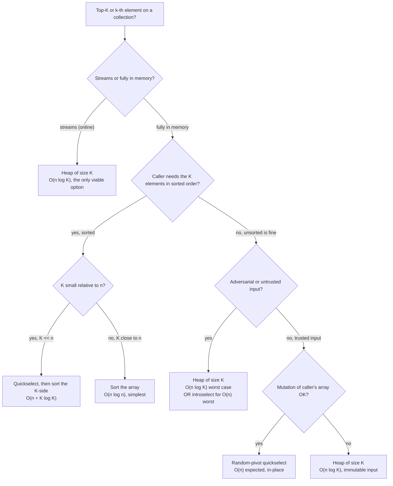

# Quickselect vs heap for top-K

Two algorithms answer "give me the top K" on an unsorted array, and the wrong choice in an interview costs you the round even when the code compiles. Heap is `O(n log K)` and survives every input you can throw at it. Quickselect is `O(n)` expected and `O(n^2)` against an adversary. The interesting fact is that neither dominates: input shape and output shape flip the answer.

## The decision

**One question, one answer.** If the data streams or arrives unbounded, you reach for a heap of size K. If the data is sitting in memory and the caller wants the top-K unsorted (or just the k-th value), you reach for quickselect. Everything else is qualifications on those two cases.

That asymmetry comes from where each algorithm needs the data. A heap of size K only ever holds the K largest survivors, so a one-pass scan over a stream is enough. Quickselect needs to swap elements across the whole array, which means you must have the whole array. The streaming-vs-static axis is the first cut, and it's a hard cut: there is no online quickselect.

## The flowchart

*Five branching questions resolve the choice. The streaming branch is one-way. The other four trade complexity, output shape, robustness, and side-effects.*

## Algorithms compared

The decision page covers two contenders in depth, plus a third that shows up in interview answers and deserves a one-paragraph demotion.

### Heap of size K (streaming-friendly default)

The shape is a min-heap bounded at K elements when you want the K *largest*, and a max-heap bounded at K when you want the K *smallest*. Walk the input, push each element, and pop the root whenever the heap exceeds K. After one pass the heap holds the K survivors, and the root is the threshold value (the k-th largest in the K-largest case).[^1]

**Pick this when:**

- The data streams. New values arrive over time and the caller wants the running top-K. LC 703 *Kth Largest Element in a Stream* is the canonical case.
- The input is untrusted or adversarial. The bound is `O(n log K)` worst case, period; no input forces it above.[^2]
- The caller needs the K elements in sorted order. Extract-all gives them sorted naturally, in `O(K log K)` after the scan.
- K is genuinely small (top-10, top-100) and `log K` is essentially a constant.
- The input array must not be mutated.

**Time:** `O(n log K)` worst case. **Space:** `O(K)`. The threshold sits at the root for `O(1)` peeks. The mechanics are one chapter away in [Heaps and the top-K pattern](../part-6-trees-heaps/04-heaps-priority-queues.md).[^3]

### Quickselect (offline speed)

Partition the array around a random pivot. The pivot lands at its final sorted position; check whether that position equals `n - k` (for k-th largest) and recurse into whichever side contains the target index. The other side never gets read.[^4]

**Pick this when:**

- The whole array is in memory and you only need the threshold value, not the K elements in any particular order.
- K is a meaningful fraction of n. For median (`K = n/2`) the heap's `O(n log K)` becomes `O(n log n)` and loses its asymptotic edge entirely. Quickselect cuts a full `log n` factor off.
- You can mutate the caller's array, or you've copied it on entry.
- The input is trusted. Random-pivot quickselect's expected-vs-worst gap is the only real argument against it: `O(n)` expected, `O(n^2)` worst on adversarially-constructed sequences.[^4]

**Time:** `O(n)` expected (random pivot), `O(n^2)` worst case without it. **Space:** `O(1)` iterative, `O(log n)` expected recursive. The mechanics live in [Quickselect: linear-time selection](../part-2-search-sort/07-quickselect.md), with the proof of expected linear time via the `E[T(n)] <= E[T(3n/4)] + cn` recurrence in CLRS Chapter 9.[^5]

A note on the worst case: Devroye's 1984 exponential-tail bound shows the probability that random-pivot quickselect takes more than `Cn` comparisons shrinks super-exponentially in `C`, so the worst case is exponentially unlikely on random inputs.[^6] Adversarial inputs against a fixed pivot rule are a different story. That is what introselect (Musser 1997) defends against: it counts recursion depth and falls back to median-of-medians at depth `2 log n`, recovering worst-case `O(n)` at constant-factor cost. `std::nth_element` in libc++ and libstdc++ does this.[^4]

### Sort, then take the prefix (the lazy default to avoid)

`sorted(nums, reverse=True)[:k]`. Always works. Always `O(n log n)`. The interview is testing whether you noticed that K and n have an asymmetry; reaching for sort is the answer that says you didn't. Use it only when K is essentially equal to n, at which point partial sort and full sort converge anyway.

## Side-by-side

The three algorithms on identical input (an offline array of `n` integers, K specified, query for the top-K or k-th value).

| Algorithm | Time avg | Time worst | Space | Streaming? | Output sorted? | Mutates? | Pick when |
|---|---|---|---|---|---|---|---|
| **Heap of size K (min-heap for top-K largest)** | `O(n log K)` | `O(n log K)` | `O(K)` | yes | yes (on extract) | no | streaming, untrusted input, sorted output, immutable input, K very small |
| **Quickselect (random pivot)** | `O(n)` | `O(n^2)` | `O(1)` iter, `O(log n)` rec | no | no | yes | offline, trusted input, K close to n/2, only need threshold |
| **Sort and slice** | `O(n log n)` | `O(n log n)` | `O(log n)` to `O(n)` | no | yes | yes (or `O(n)` to copy) | K close to n, simplest implementation wins, anything else is overkill |

The expected-vs-worst gap is the entire reason quickselect can't be the universal answer. On a random input distribution, quickselect beats the heap by a measurable but small constant. Daniel Lemire's microbenchmark on top-K queries over 64-bit integers reported quickselect at roughly 45,000 ops/sec versus a binary-heap implementation at 37,000 ops/sec on the same input shape, around a 20% speedup.[^7] On adversarial input against a deterministic pivot rule, quickselect is `O(n^2)` and the heap is unchanged. The heap's `log K` factor is what you pay for that guarantee.

The crossover where the two break even is roughly when `log K` matches quickselect's `~3.4` constant for the median target. K = 10 puts `log K` near 3.3; K = 1000 puts it near 10. Quickselect dominates the asymptotic comparison once K crosses a few hundred; below that, the heap is competitive on real machines and easier to write under time pressure.

## Three signature problems

The three problems most-asked at FAANG-tier loops, with which algorithm fits and why.

### LC 215 — Kth Largest Element in an Array (Medium)

Both algorithms apply. The official LeetCode editorial walks heap first, then quickselect.[^8] [LC 215](https://leetcode.com/problems/kth-largest-element-in-an-array/) is the chapter signature for [Quickselect: linear-time selection](../part-2-search-sort/07-quickselect.md), where the quickselect path lives in full. The interview play is to state the heap solution as the readable answer, then offer quickselect as the optimization: "if you want `O(n)` expected, I can replace this with quickselect; the trade-off is `O(n^2)` against adversarial input, mitigatable with a random pivot or introselect."

### LC 347 — Top K Frequent Elements (Medium)

Heap-natural. The first stage is a hash map of `(value, count)` pairs in `O(n)`; the second stage runs a size-K min-heap on the count dimension. Quickselect on the `(value, count)` pairs is also valid and gives `O(n)` expected, but the heap reads cleaner and the count-keyed comparator transfers directly into the heap API. [LC 347](https://leetcode.com/problems/top-k-frequent-elements/).

### LC 973 — K Closest Points to Origin (Medium)

Both algorithms apply, with the same calculus as LC 215. The key is the squared distance from origin; the comparator runs on the key, the swap moves the compound `(x, y)` object. Quickselect on the derived key is the chapter signature for the quickselect chapter; the heap version with `(squared_distance, x, y)` tuples is the safe interview default. [LC 973](https://leetcode.com/problems/k-closest-points-to-origin/).

LC 215 and LC 973 also surface in [Top-K via heap or quickselect](./P-30-top-k-heap-or-quickselect.md), the archetype page that handles signal recognition; this decision page handles the mechanics choice once the *yes, top-K* signal has fired. The broader data-structure question (heap versus a sorted array versus a balanced BST) lives in [Heap vs sorted array vs BST for top-K](./P-06-heap-vs-sorted-array-vs-bst.md).

## Common misconceptions

Five mental models that look right and cost interview points.

### "Heapsort is faster than quickselect for top-K because heaps are tight."

Wrong direction. Heap-of-K is `O(n log K)`. Quickselect is `O(n)` expected. Quickselect wins asymptotically on offline batches, and the constant factor agrees: the Lemire benchmark shows quickselect roughly 20% faster than the heap on 64-bit integer top-K queries on the same input shape.[^7] The heap's correct argument is robustness (worst-case `O(n log K)`, no adversarial input forces it above), streaming-friendliness, and ease of implementation under time pressure, not raw speed. Confusing "the heap is the safe interview default" with "the heap is faster" is the bug.

### "Quickselect is `O(n^2)` worst case, so don't use it in production."

Half right. Plain Lomuto-with-fixed-pivot is `O(n^2)` worst case, and an adversary picking inputs against a known pivot rule will hit it on every call. Random-pivot quickselect is `O(n^2)` worst case in name only: Devroye's 1984 exponential tail bound says the probability of exceeding `Cn` comparisons shrinks super-exponentially in `C`, so on random inputs the bound is reached with probability that vanishes faster than any polynomial in `1/C`.[^6] Production code that worries about adversarial input uses introselect: random pivot with a depth counter that falls back to median-of-medians at `2 log n`, recovering worst-case `O(n)` for a small constant-factor tax. `std::nth_element` does exactly this.[^4] The honest framing is: never ship plain Lomuto with a deterministic pivot, always ship random pivot or introselect; "don't use quickselect" is too strong.

### "Heapify the whole array, then pop K times."

`heapify(nums)` is `O(n)` by Floyd's bound, which sounds like a good start.[^1] The K extracts that follow are `O(log n)` each, giving `O(n + K log n)`. For K = n/2 that's `O(n log n)`, no improvement over sort. The size-K idiom (push, then pop-if-overflow) is `O(n log K)`, asymptotically better whenever K is meaningfully smaller than n. The trick is to flip the heap polarity (use a min-heap when finding top-K-largest) and bound the size at K. Every textbook gets this right; every first-time submission gets it wrong.

### "A heap of size K means K elements at all times."

Some implementations push first, then pop on overflow, so the heap briefly holds K+1 elements. Others use `heappushpop` in a single call when the heap is already at K — the new value displaces the root only if it beats the threshold, and the heap stays at exactly K. Both are correct; the K+1 transient is fine because the asymptotic bound is the same (`O(log K)` per arrival in either form). The one place this matters is space-tight environments where you genuinely cannot allocate a K+1-th slot, and there `heappushpop` is the right primitive. `heapq.heappushpop` in Python and the equivalent in libc++'s `priority_queue` adapter are the canonical references.

### "Quickselect on a streaming input."

Doesn't exist. Partition operates on indices `[lo, hi]` of a fully-loaded array; there is no way to partition a stream you've only seen part of. Trying to apply quickselect to LC 703 *Kth Largest Element in a Stream* is the most common version of the bug, and it's a hard fail: the algorithm cannot be retrofitted into an online form. Heap of K is *the* streaming top-K data structure, and the chapter at 6.4 carries the worked example.[^3]

## References

[^1]: Cormen, Leiserson, Rivest, Stein, *Introduction to Algorithms*, 4th ed., MIT Press, 2022, Ch. 6.

[^2]: Wikipedia, "Partial sorting." https://en.wikipedia.org/wiki/Partial_sorting

[^3]: DSA Handbook, [Heaps and priority queues](../part-6-trees-heaps/04-heaps-priority-queues.md).

[^4]: Wikipedia, "Quickselect." https://en.wikipedia.org/wiki/Quickselect

[^5]: Cormen, Leiserson, Rivest, Stein, *Introduction to Algorithms*, 4th ed., MIT Press, 2022, Ch. 9.

[^6]: Devroye, "Exponential bounds for the running time of a selection algorithm," *J. Computer and System Sciences* 29(1) (1984): 1–7. https://doi.org/10.1016/0022-0000(84)90009-6

[^7]: Lemire, "QuickSelect versus binary heap for top-k queries," 2017. http://eklausmeier.goip.de/lemire/blog/2017/06-14-quickselect-versus-binary-heap-for-top-k-queries

[^8]: NeetCode, "Kth Largest Element in an Array." https://neetcode.io/problems/kth-largest-integer-in-an-array
